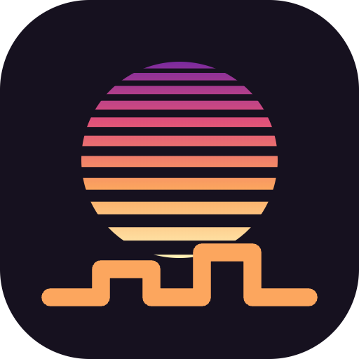
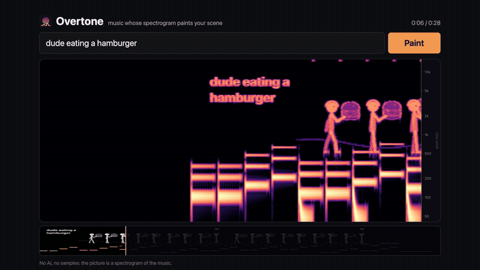
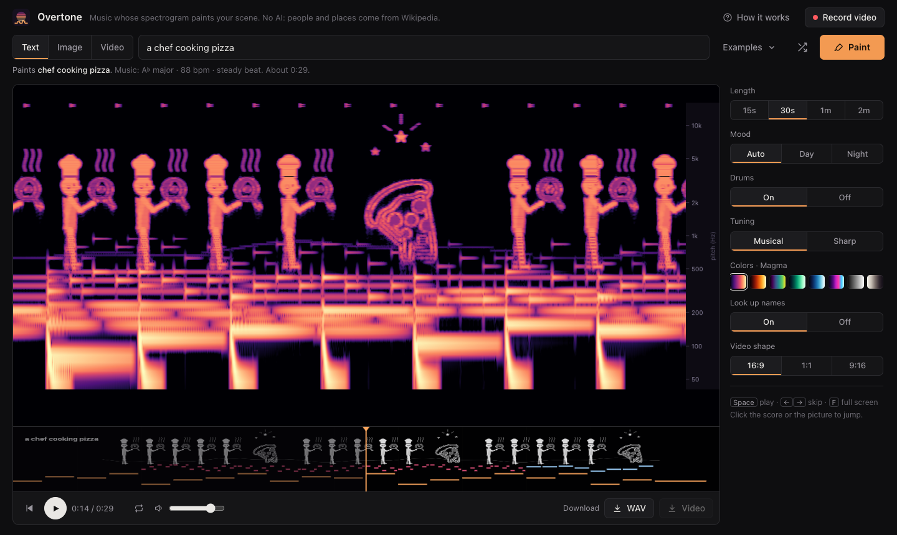

  

<h1 align="center">Overtone</h1>

  <strong>Type a scene. Overtone writes music whose spectrogram paints it.</strong> 
  A dog chasing a ball, a cat walking home under the moon, Leonardo painting the Mona Lisa: every shape you see is the sound itself.

  
  
  
  
  
  
  
  

  <a href="#try-it">Try it</a> ·
  <a href="#how-it-works">How it works</a> ·
  <a href="#what-it-can-paint">What it can paint</a> ·
  <a href="#record-a-video">Record a video</a> ·
  <a href="#testing-status">Testing status</a>

  

**AI disclosure:** Overtone was built with substantial AI assistance for code, testing and documentation. The app itself uses no AI: scenes come from a hand-written sketchbook, a word planner and Wikipedia lookups, and the music follows fixed rules.

## What it is

A spectrogram is a picture of sound: left to right is time, bottom to top is pitch, and brightness is loudness. Programs like MetaSynth turn images into sound. Overtone does it the other way round, starting from words: you describe a scene, it draws the scene in white ink, turns every bright pixel into a quiet sine wave at that pitch, and composes a bass line, chords, arpeggios and drums underneath. The screen then shows a live spectrogram of what you hear, and the scene appears out of the music.

  

## Try it

1. Download or clone this repository.
2. On a Mac, double-click **Open Overtone.command**. It serves the folder on a local port and opens it in your browser; close its window to stop. You can also open **index.html** in Chrome or Safari directly. There's nothing to install or build.
3. Type a scene, turn your sound on and press **Paint**.

The first time, macOS may say the launcher is from an unidentified developer: right-click it and choose **Open**.

Looking up names on Wikipedia needs a normal browser tab with an internet connection. Embedded previews, like an editor's file viewer, can paint the built-in drawings but can't go online.

## How it works

1. **Read the sentence.** The planner finds who is in it, what they do and what they do it to: "dude eating a hamburger" means a dude, eating, a hamburger. It fixes small typos and shows its plan under the prompt before you paint.
2. **Act it out.** Posed stick figures play the action: eating takes bites until the food is gone, throwing a javelin runs up, winds up and lets go, arguing trades speech bubbles. People dress for their role (a chef's hat, a crown, shades for a dude), kids are smaller and groups walk together. The scene stretches to the length you pick by repeating the action, never by adding unrelated scenery.
3. **Find what it doesn't know.** About 1,200 everyday things are traced from the open [Noto Emoji](https://github.com/googlefonts/noto-emoji) set, which ships with the app. Names, places and works it has no drawing for, like Leonardo da Vinci or the Eiffel Tower, are looked up on Wikipedia, and the article's pictures are traced into line art.
4. **Write the music.** A plucked bass, a soft pad, arpeggios with an echo, a lead line and drums, all kept below the picture so they never draw over it. The words choose the key, tempo, chord progression, bass line, drum feel and melody: "racing" speeds it up, "sleeping" slows it down. Picture rows are tuned to the overtones of each chord, so the drawing sounds like part of the harmony. Moving things, like a thrown ball, are traced by melody notes.
5. **Listen.** The display is only a spectrogram of the audio. Open the WAV in any spectrogram viewer, like Audacity or Spek, and the same picture appears.

| Axis | Meaning |
|---|---|
| Left to right | Time, 120 pixels per second |
| Bottom to top | Pitch, 40 Hz to 16 kHz on a log scale. The ground line sits at 500 Hz. |
| Brightness | Loudness |

## What it can paint

| From | Examples |
|---|---|
| **Actions** | eat, drink, cook, play an instrument, sing, throw, kick, run, jump hurdles, dance, swim, ride a bike or horse, fly a kite, walk the dog, hug, talk, argue, fight, think, fly, laugh, cry, sit, read, sleep |
| **Built-in drawings** | dogs, cats, horses, rabbits, birds, butterflies, fish, whales, boats, cars, trains, rockets, planes, cities, houses, trees, flowers, mountains, rain and storms, sun, moon and stars, Olympic rings and stadiums |
| **Emoji, traced** | about 1,200 nouns, from elephants and guitars to pizza and castles |
| **Wikipedia** | people, places, paintings, landmarks, characters and bands, shown as traced pictures from their articles (freely licensed pictures only) |
| **Your files** | an image becomes a line drawing or keeps its shading; a video becomes a film strip of its frames |

Anything it still can't place is written out as lettering, and the plan line says so.

## Record a video

**Record video** types your prompt on screen, presses Paint, records the scene painting itself with sound, and ends on a title card. It saves an MP4 (H.264 and AAC) that X accepts, in 16:9 at 1920×1080, 1:1 at 1080×1080 or 9:16 at 1080×1920. **Caption** copies a short post, and **WAV** saves the audio alone.

Recording runs in real time, so keep the tab in front. Files run about 0.6 MB per second: a 30-second 1080p video is about 18 MB.

## Controls

| Control | What it does |
|---|---|
| **Remix** | Same scene, new key, chords and arrangement |
| **Length** | 15 s, 30 s, 1 min or 2 min |
| **Mood** | Auto (from your words), Day (major) or Night (minor) |
| **Drums** | On or off |
| **Tuning** | Musical (rows follow the chord's overtones) or Sharp (evenly spaced: a crisper picture, a noisier sound) |
| **Colors** | Eight spectrogram palettes |
| **Look up names** | Turn Wikipedia lookups on or off |
| **Score** | Click or drag to jump anywhere; click the spectrogram to replay a moment |
| **Keys** | Space play or pause, ← → skip 2 s, F full screen |

Settings and your last prompt are remembered between visits.

## Privacy

Everything runs on your computer. Images and videos you load never leave it. When **Look up names** is on, only the unknown words in your prompt are sent to Wikipedia's public search, and the article pictures are downloaded from Wikimedia.

## Testing status

| Area | Status |
|---|---|
| Chrome (macOS) | Painting, scrubbing, settings, recording and Wikipedia lookups tested |
| Safari (macOS) | Painting, recording (1080p MP4) and Wikipedia lookups tested |
| Firefox, Windows, phones | Not tested |
| Recorded MP4s | Checked with ffprobe and frame grabs: H.264 High, AAC, 16:9 and 9:16 |
| Prompts | 48 prompts checked automatically, plus 5 that need Wikipedia. Unusual sentences can still be misread, and some Wikipedia pictures trace roughly. |

Run the checks with `node tests/run.mjs` (add `--web` for the Wikipedia ones). They need Node 22 and Google Chrome, no packages. Each prompt in [tests/cases.js](tests/cases.js) lists what its plan must and must not say, and the audio for two prompts is checked for silence and clipping.

## Project layout

| File | What it does |
|---|---|
| `index.html` | Layout and styles |
| `app.js` | Interface, audio graph, live spectrogram, score, recording |
| `engine.js` | Music, synthesis, color palettes, FFT, WAV export |
| `sketchbook.js` | Drawings, poses, costumes, the scene planner, Wikipedia lookups, image and video tracing |
| `emoji-words.js` | About 1,200 nouns mapped to emoji, generated from Unicode emoji names |
| `emoji-font.js` | The Noto Emoji font, trimmed to the emoji Overtone uses |
| `Open Overtone.command` | Double-click launcher for macOS |
| `tests/` | Prompt checks |
| `icon.svg` | Logo |

To add a drawing, write a function in `sketchbook.js` and add an entry to `SUBJECTS` with the words that should trigger it.

## License and credits

Overtone's code is under the [MIT License](LICENSE).

- **Emoji:** [Noto Emoji](https://github.com/googlefonts/noto-emoji) by Google, under the [SIL Open Font License 1.1](licenses/OFL-NotoEmoji.txt), bundled in `emoji-font.js`.
- **Wikipedia pictures** are downloaded when you paint, never shipped with the app. Overtone uses only freely licensed files from Wikimedia Commons and skips "fair use" ones. Each video's end card credits the author and license of every picture it shows, and **Caption** adds the full credits to your post.
- Inspired by a clip of a spectrogram painted with music, and by MetaSynth, which turns images into sound.
